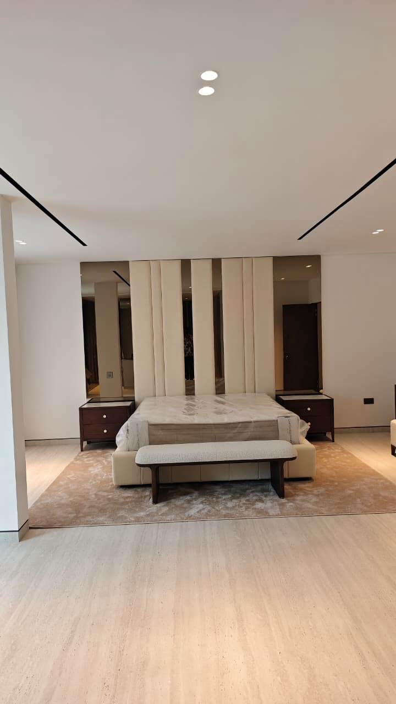

# Solidscape Contracting LTD — Website

A four-page responsive website for **Solidscape Contracting LTD**, a home
renovation company in Dubai, built to replace the company's current site.
It is written in plain HTML, CSS and JavaScript, with a small Node.js / Express
server that emails contact-form enquiries to the company.

## Pages

| Page | File | Purpose |
|---|---|---|
| Home | `index.html` | First impression: what the company does, three key strengths, call to action |
| About Us | `about.html` | Company story, mission and values |
| Our Work | `showcase.html` | Six completed projects, each with a swipeable photo carousel; click a photo to enlarge it |
| Contact Us | `contactus.html` | Phone, email, location and an enquiry form |

## File structure

```
.
├── index.html          Home page
├── about.html          About Us page
├── showcase.html       Project showcase (photo carousels + lightbox)
├── contactus.html      Contact details + enquiry form
├── styles.css          The single external stylesheet used by every page
├── script.js           Client-side JavaScript (menu, carousels, lightbox, form validation)
├── server.js           Express server: serves the site and emails form enquiries
├── assets/             Logo and social icons
│   └── projects/       One folder of carousel photos per project (project1-6)
├── docs/
│   ├── planning.md     Audience note, site map and wireframes
│   └── testing.md      Test table, compatibility and usability checks
├── package.json        Node dependencies (express, nodemailer, dotenv)
├── .env.example        Template for the private .env settings file
└── .gitignore          Keeps .env, node_modules and assignment files out of Git
```

## How it works

- **HTML** – each page uses semantic elements (`header`, `nav`, `main`,
  `section`, `article`, `figure`, `address`, `footer`). The header, navigation
  and footer are identical on every page so the site feels consistent.
- **CSS** – one external stylesheet (`styles.css`). Colours are stored as CSS
  variables in `:root`. The nav links change colour on hover and the current
  page is underlined. Grouping selectors (e.g. `.hero h1, .page-hero h1`) share
  styles, and descendant selectors (e.g. `.project-card:hover .project-image img`)
  style elements only inside a particular parent. Two media queries (900px and
  650px) adapt the layout for tablets and phones.
- **JavaScript** (`script.js`)
  - `toggleMenu()` – clicking ☰ opens/closes the navigation on small screens.
  - `setUpCarousel()` / `goTo()` – each project has a photo carousel. The
    arrows, dots and counter are built automatically from however many photos
    are in the list, so adding a photo only takes one line of HTML (see below).
    Photos can be swiped on phones (CSS scroll-snap) and changed with the
    left/right arrow keys. It follows the WAI-ARIA carousel pattern: labelled
    region and slides, real buttons with labels, a live region announcing
    "Photo 2 of 4", hidden photos made `inert`, no auto-play, and no animation
    when the visitor has *reduce motion* switched on.
  - `openLightbox()` / `closeLightbox()` – clicking a project photo shows it
    full size; clicking the background or × closes it (Escape also works).
    Photos are buttons, so the lightbox also opens from the keyboard, and
    focus returns to the photo when it closes.
  - `validateForm()` – checks the contact form before sending: required fields
    are present, name/message are within length limits, email and phone are in
    a valid format, and the start date is not in the past. Each problem is
    shown under the field it relates to.
  - `updateCharCount()` – live character counter for the message box.
- **Server** (`server.js`) – checks the form again (never trust the browser
  alone) and sends it as a plain-text email using Nodemailer. Only the public
  site files are served, so `.env` and source files can't be downloaded.

## Adding a project photo

Each project's photos live in their own folder, `assets/projects/project1/`
to `assets/projects/project6/`, numbered in the order they appear. Put the new
photo in the right folder, then in `showcase.html` find that project's
`<ul class="carousel-track">` and add one line:

```html
<ul class="carousel-track">
  <li></li>
  <li></li>
</ul>
```

Add `loading="lazy"` to every photo except the first, so the page loads quickly.
Photos not currently used on the site are kept in `assets/projects/unused/`.

Always write a short `alt` description of what the photo shows. A project with
one photo shows no arrows or dots; they appear as soon as there are two.

## Running it locally

1. Install [Node.js](https://nodejs.org/) (v18 or newer).
2. Install dependencies:
   ```bash
   npm install
   ```
3. Copy `.env.example` to `.env` and fill in your email (SMTP) details.
   `.env` is listed in `.gitignore` so passwords are never committed.
4. Start the server:
   ```bash
   npm start
   ```
5. Open <http://localhost:3000>.

The pages also open directly in a browser without the server, but the contact
form needs the server to send emails.

### Environment variables

| Variable | Default | Description |
|---|---|---|
| `PORT` | `3000` | Port for the Express server |
| `EMAIL_HOST` | – | SMTP host address |
| `EMAIL_PORT` | `587` | SMTP port (`465` uses SSL) |
| `EMAIL_USER` | – | SMTP username (email address) |
| `EMAIL_PASS` | – | SMTP password or app password |
| `EMAIL_FROM` | `EMAIL_USER` | Address the enquiry emails are sent from |
| `EMAIL_TO` | `contact@solidscape-uae.com` | Where enquiries are delivered |

## Planning and testing

- Planning (audience, site map, wireframes): [`docs/planning.md`](docs/planning.md)
- Testing (tests, failures and fixes, browsers, screen sizes, visitor task):
  [`docs/testing.md`](docs/testing.md)
